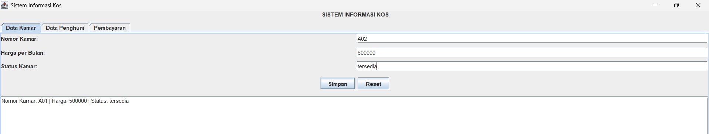
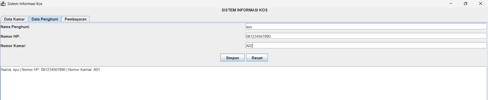
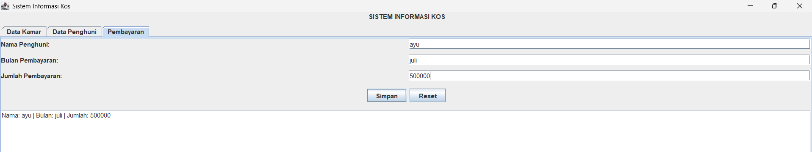

# tugasPBO

Nama: Dita Ayu Julita
NIM: F1D02410111

Sistem Informasi Kos
Sistem ini dibuat untuk membantu pengelolaan informasi kos secara sederhana, yang dapat mendata kamar, penghuni, dan pembayarannya. 

Sistem ini memiliki 3 menu utama yaitu:
1. Data Kamar yang digunakan untuk memasukkan informasi nomor kamar, harga kamar per bulan, dan status kamar.
2. Data Penghuni digunakan untuk memasukkan informasi nama penghuni, nomor HP, dan nomor kamar yang ditempati.
3. Pembayaran digunakan untuk memasukkan informasi nama penghuni, bulan pembayaran, dan jumlah pembayaran.

Terdapat tombol Simpan untuk menambahkan data ke area tampilan dan tombol Reset untuk mengosongkan kolom input.

5 Komponen GUI Utama yang Digunakan
1. JFrame menggunakan Top-Level Container yang digunakan sebagai jendela utama sistem, JFrame menampilkan seluruh tampilan Sistem Informasi Kos.
2. JPanel untuk mengelompokkan dan menyusun komponen GUI seperti label, kolom input, dan tombol.
3. JLabel untuk menampilkan teks atau keterangan pada sistem seperti judul sistem dan nama setiap kolom input.
4. JTextField untuk menerima input teks dari user seperti nomor kamar, nama penghuni, dan jumlah pembayaran.
5. JButton untuk menjalankan suatu tindakan ketika diklik seperti tombol Simpan dan Reset.

Screenshot tampilan:

